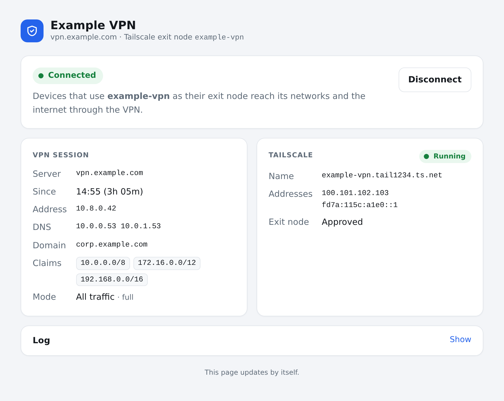
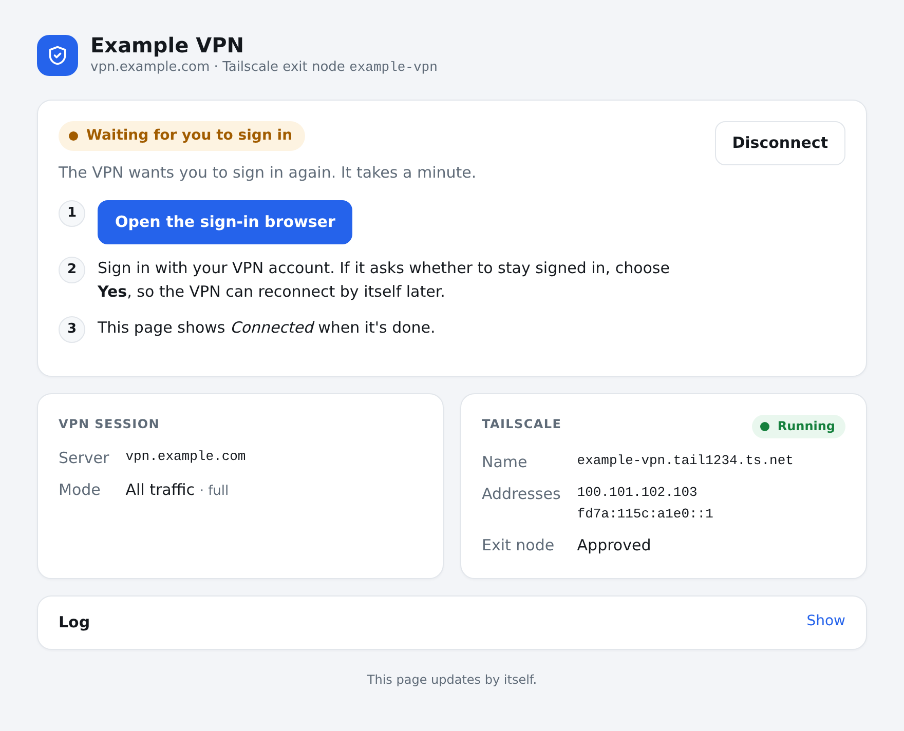

# AnyConnect VPN as a Tailscale exit node

A Cisco AnyConnect (Cisco Secure Client) VPN, in a container that is also a Tailscale
exit node. Devices on your tailnet that use it as their exit node reach the VPN's
networks, and with `ROUTE_MODE=full` the internet too, from the VPN's address.

It's for servers that sign in through single sign-on (SAML, such as Microsoft Entra ID),
which Cisco's client does in its own browser window. Here that's Chromium on a virtual
display, which you can open from any device on the tailnet. Servers that only ask for a
username and password in the client aren't supported.

- **Status and sign-in page:** `http://<TS_HOSTNAME>/`
- **Sign-in browser** (noVNC): `http://<TS_HOSTNAME>:6080/vnc.html`

## At a glance


Pick this node as the exit node in Tailscale on any device, and that device's traffic
goes through the VPN, without a VPN client on the device itself. The container keeps
the VPN connected. When the VPN wants you to sign in again, its status page says so and
gives you a browser to do it in.

## Status page





## Setup

1. Copy `.env.example` to `.env`, and set at least `VPN_SERVER` and `TS_HOSTNAME`.
   Every setting is explained there.
2. `docker compose up -d --build`.
3. `docker compose logs` shows a Tailscale login URL; open it. Or set `TS_AUTHKEY` in
   `.env` before the first start.
4. In the Tailscale admin console, approve the node as an exit node, and consider
   disabling key expiry for it. Your tailnet policy has to let the devices that should
   use it reach `autogroup:internet`.
5. Open `http://<TS_HOSTNAME>/` and sign in through the sign-in browser.

## How it works

- `openconnect` holds the VPN tunnel (`tun0`).
- `web.py` drives the sign-in in Chromium, gets the VPN session cookie from the server
  and starts openconnect with it. It identifies as Cisco's client, since servers only
  offer single sign-on to that.
- The browser profile is kept in the `browser` volume. While the identity provider
  remembers the sign-in (answer *Yes* when it asks whether to stay signed in), a session
  that ends reconnects by itself. When it wants you again, the status page says
  *Waiting for you to sign in*.
- `vpn-script` wraps the stock `vpnc-script`, which sets up the routes and DNS servers
  the VPN pushes, and NATs exit-node traffic into the tunnel.

## Routing

`ROUTE_MODE=full` (the default) sends all traffic from devices using the exit node into
the VPN, so they reach the internet from the VPN's address. DNS from those devices goes
to the VPN's DNS servers, so the VPN's internal names resolve.

If the VPN's DNS servers are slow or unreliable, set `DNS_SERVERS` to others, such as
`1.1.1.1 8.8.8.8`. The VPN's internal names then don't resolve, but everything else does.

Many AnyConnect servers are split tunnel: they only claim some ranges. With
`ROUTE_MODE=split`, devices using the exit node reach those through the VPN and the
internet through this host's connection. The status page lists the ranges the VPN claims.

Tailscale's own connections never go into the VPN, even when it claims your LAN's range
(such as all of 192.168/16), so Tailscale can still connect directly to devices on
whatever network the host is on.

## Direct connections from the LAN

Inside Docker, the container's Tailscale only knows its Docker and VPN addresses. Devices
on your LAN that can't be reached from outside, such as containers or VMs behind their
own NAT, would then only reach it through Tailscale's relay (DERP), at a fraction of the
speed. So tailscaled listens on a fixed port (`TS_PORT`, default 41642, not the host's
own Tailscale port 41641), Docker publishes it on the host, and with `TS_LAN_ADDRESS`
the container announces the host's LAN address with it.

The container can't see the host's LAN address itself, so this one setting is up to you,
and it's optional:

- On a machine that stays put, set it, and give the machine a DHCP reservation.
- On a laptop that changes networks, leave it out. Tailscale still connects directly
  where it can, and through a relay otherwise. A stale address does no harm either:
  it's just one more address Tailscale tries.
- It's done with `TS_DEBUG_PRETENDPOINT`, a Tailscale debug setting. If a later Tailscale
  drops it, devices fall back to the relay too; nothing else breaks.
- To check: `tailscale ping <TS_HOSTNAME>` from a device on the LAN says
  `via <TS_LAN_ADDRESS>:41642`, not `via DERP`.

Devices outside your network, such as a phone on mobile data, connect directly too if
your router forwards `TS_PORT` (UDP) to the host. The container already announces your
public address with that port, so nothing else needs setting. Without the forward they
connect directly where hole punching works, and through a relay otherwise.

## Sign-in expiry

VPN servers end sessions after a while, often 12 or 24 hours. A new one starts by itself
while the identity provider remembers the sign-in. If you leave the sign-in browser
waiting for a long time, the server's request expires and it shows "Validation failure";
the container then starts over by itself, and the **Open the sign-in browser** link
always starts a fresh one.

## Commands

```sh
docker compose up -d --build     # build and start
docker compose logs -f           # openconnect and tailscaled output
docker compose down              # stop; logs the VPN session off
```
