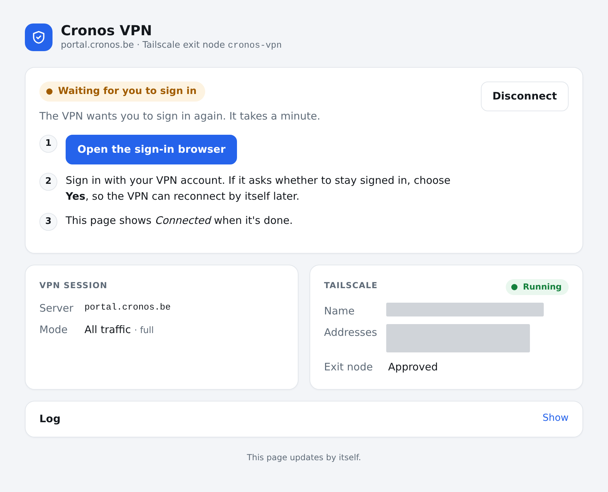
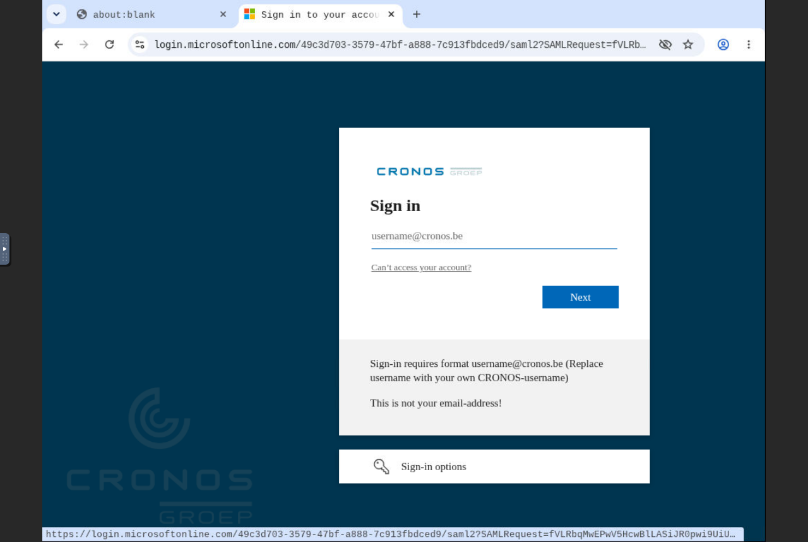
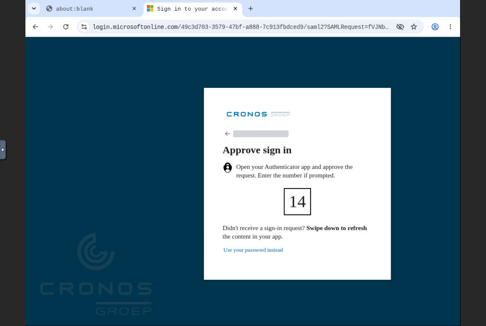
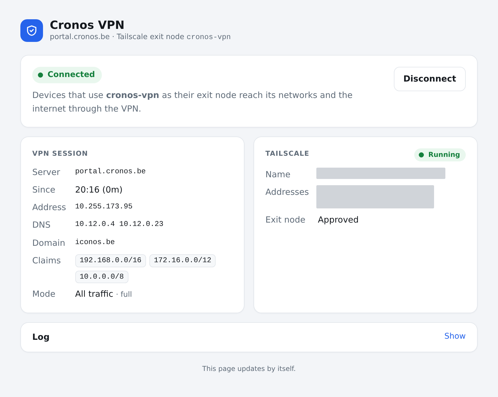

# Cronos

Notes on using this with the Cronos VPN: what to know about the VPN, the settings to
use, and what signing in again looks like.

## The VPN

- **Server:** `portal.cronos.be`, Cisco Secure Client (AnyConnect).
- **Sign-in:** Microsoft Entra ID (Azure AD), with your Cronos account. When Microsoft
  asks *Stay signed in?*, choose **Yes**, so the VPN reconnects by itself.
- **Sessions** last 12 hours.
- **Split tunnel:** the VPN only claims the private ranges, 10/8, 172.16/12 and
  192.168/16. That includes most home networks; Tailscale's own connections stay out
  of the VPN, so that's no problem.
- **DNS:** the VPN's servers are `10.12.0.4` and `10.12.0.23`, with domain `iconos.be`,
  so internal names (`*.iconos.be`) resolve on devices using the exit node in
  `ROUTE_MODE=full`. The settings below use public DNS servers instead, since the VPN's
  can give trouble; leave `DNS_SERVERS` out if you need the internal names.
- **Public address:** with `ROUTE_MODE=full`, devices using the exit node reach the
  internet from a Cronos address, such as `94.143.189.241` or `94.143.189.242`. That's
  what IP allowlists, like the Cronos GitLab's, see.

## Settings

A `.env` for the Cronos VPN. It works on any network, a laptop's included.

```sh
VPN_SERVER=portal.cronos.be
VPN_NAME=Cronos VPN
TS_HOSTNAME=cronos-vpn
ROUTE_MODE=full
DNS_SERVERS=1.1.1.1 8.8.8.8
AUTO_CONNECT=true
TZ=Europe/Brussels
```

On a machine that stays on one network, you can add its LAN address, so devices there
connect to it directly (see the README):

```sh
TS_LAN_ADDRESS=192.168.0.10
```

`TS_HOSTNAME` is the node's name on your tailnet, so pick another one if `cronos-vpn` is
taken there. Its status page is then `http://<TS_HOSTNAME>/`.

## Signing in again

The VPN reconnects by itself after each 12-hour session, as long as Microsoft remembers
the sign-in. Choosing *Stay signed in?* → **Yes** keeps it for about 90 days. After that,
or when Cronos asks for a new sign-in sooner, the VPN waits for you:

1. **The status page says *Waiting for you to sign in*.** Devices using the node as
   their exit node aren't going through the VPN until you do. Click **Open the
   sign-in browser**.

   

2. **Sign in with your Cronos username** (`username@cronos.be`, not your email address).
   The sign-in browser is Chromium in the container, which noVNC shows in your own
   browser.

   

3. **Approve it in Microsoft Authenticator**, entering the number the page shows. When
   Microsoft asks *Stay signed in?*, choose **Yes**.

   

4. **The status page says *Connected*** within a few seconds, and the sign-in tab closes
   by itself.

   

To make it ask for a sign-in now, such as to renew the 90 days before a trip, start the
browser with an empty profile. The old one is kept until you remove it:

```sh
# In the repository's directory:
docker compose stop
docker compose run --rm --no-deps --entrypoint sh vpn -c 'cd /var/lib/vpn-exit-node && mv browser browser.saved'
docker compose start
# After signing in, remove the old profile. Or, to undo, move it back (stop first).
docker compose run --rm --no-deps --entrypoint sh vpn -c 'rm -rf /var/lib/vpn-exit-node/browser.saved'
```
